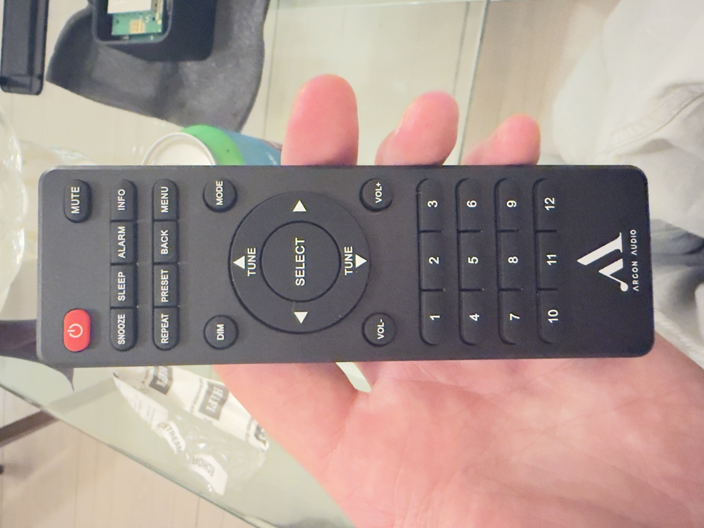

# Argon Audio Stream2M MK2 IR remote codes

These are the infrared codes for the original remote of the Argon Audio Stream2M MK2 music streamer. Use them to control the streamer when the remote is lost. They work from ESPHome, a Flipper Zero, LIRC, or a Broadlink blaster in Home Assistant.

The codes were captured from an original Argon Stream2M MK2 remote on 2026-10-28.

## Protocol

- **Protocol:** extended NEC (NECext) on a 38 kHz carrier.
- **Address:** the two address bytes `CC 1D`, sent in that order.
  - ESPHome writes this as `address: 0x1DCC`.
  - LIRC writes it as `pre_data 0x33B8`, because LIRC shows bits in reverse order.
- **Command:** one byte per button, followed by its inverse.

The second address byte is not the inverse of the first. That is what makes it extended NEC. A tool that only sends standard NEC can't produce these codes. This is also why codes for other Argon remotes don't work on this streamer. The Argon Stream 3 MK1 remote, for example, uses standard NEC with address `0x01`.

The streamer is built on a Frontier Silicon Venice 6.5 module (FS0152-6).

## Buttons

`Command` is the button's byte. The other two columns are the same code written the way ESPHome and LIRC expect it.

| Button | Command | ESPHome command | LIRC (32-bit) |
|---|---|---|---|
| Power | 0x2A | 0xD52A | 0x33B854AB |
| Mute | 0x2B | 0xD42B | 0x33B8D42B |
| Snooze | 0x26 | 0xD926 | 0x33B8649B |
| Sleep | 0x27 | 0xD827 | 0x33B8E41B |
| Alarm | 0x28 | 0xD728 | 0x33B814EB |
| Info | 0x29 | 0xD629 | 0x33B8946B |
| Repeat | 0x22 | 0xDD22 | 0x33B844BB |
| Preset | 0x23 | 0xDC23 | 0x33B8C43B |
| Back | 0x24 | 0xDB24 | 0x33B824DB |
| Menu | 0x25 | 0xDA25 | 0x33B8A45B |
| Dim | 0x20 | 0xDF20 | 0x33B804FB |
| Mode | 0x21 | 0xDE21 | 0x33B8847B |
| Tune Up | 0x06 | 0xF906 | 0x33B8609F |
| Tune Down | 0x05 | 0xFA05 | 0x33B8A05F |
| Left | 0x07 | 0xF807 | 0x33B8E01F |
| Right | 0x08 | 0xF708 | 0x33B810EF |
| Select | 0x04 | 0xFB04 | 0x33B820DF |
| Vol- | 0x1B | 0xE41B | 0x33B8D827 |
| Vol+ | 0x1A | 0xE51A | 0x33B858A7 |
| 1 | 0x11 | 0xEE11 | 0x33B88877 |
| 2 | 0x12 | 0xED12 | 0x33B848B7 |
| 3 | 0x13 | 0xEC13 | 0x33B8C837 |
| 4 | 0x14 | 0xEB14 | 0x33B828D7 |
| 5 | 0x15 | 0xEA15 | 0x33B8A857 |
| 6 | 0x16 | 0xE916 | 0x33B86897 |
| 7 | 0x17 | 0xE817 | 0x33B8E817 |
| 8 | 0x18 | 0xE718 | 0x33B818E7 |
| 9 | 0x19 | 0xE619 | 0x33B89867 |
| 10 | 0x00 | 0xFF00 | 0x33B800FF |
| 11 | 0x10 | 0xEF10 | 0x33B808F7 |
| 12 | 0x01 | 0xFE01 | 0x33B8807F |

Buttons 10, 11 and 12 don't follow the pattern of 1 to 9. They were captured twice to rule out a mix-up.

## Files

- `codes.csv`: the button table, plus the address bytes, for scripts.
- `esphome/argon-stream2m-mk2.yaml`: one ESPHome button per remote button.
- `flipper/Argon_Stream2M_MK2.ir`: a Flipper Zero remote file.
- `lirc/argon-stream2m-mk2.lircd.conf`: a LIRC remote definition.
- `broadlink/argon-stream2m-mk2.broadlink.json`: Broadlink base64 codes, for example for Home Assistant's `remote.send_command`.
- `pronto/argon-stream2m-mk2.pronto.json`: Pronto hex codes, for universal remotes and Home Assistant integrations that take Pronto.

## Use the codes with ESPHome

1. Add a `remote_transmitter` with `id: ir` to your device. An IR LED on a GPIO pin works, with `carrier_duty_percent: 50%`.
2. Copy the `button:` entries from `esphome/argon-stream2m-mk2.yaml` into your config.
3. Point the LED at the streamer's front panel and press a button in Home Assistant or the ESPHome web page.

Each button sends `remote_transmitter.transmit_nec` with `address: 0x1DCC` and the command from the table.

## Control it without an IR LED

You can also connect a microcontroller straight to the output pin of the streamer's IR receiver. The receiver sits on a small board behind the front panel. This replaces the light with a wire, so aiming no longer matters.

On the unit these codes came from, the receiver ran at 3.3 V:

- The middle leg was ground.
- One outer leg was the supply.
- The other outer leg was the output.

Measure yours before you connect anything. Then:

1. Connect your microcontroller's ground to the streamer's ground.
2. Connect a GPIO pin to the receiver's output leg. Never to the supply leg.
3. Set that pin to open-drain and inverted, so it only pulls the line low, the way the receiver does.
4. Send the codes with no carrier. In ESPHome that is `carrier_duty_percent: 100%`.

To find the output leg, point any IR remote at the streamer while you read each outer leg. The output is the one that changes.

## How the codes were checked

- All 31 buttons were captured from the original remote with an ESP32-C6 on the streamer's own IR receiver output. Every command byte arrived with its correct inverse.
- Buttons 10, 11 and 12 were captured a second time and gave the same codes.
- Sending Tune Down and Tune Up over a wire moved the selection in the streamer's Wi-Fi setup menu.
- The Pronto and Broadlink files were generated from the codes and decoded back to the captured bytes.

The Flipper Zero, LIRC, Broadlink and Pronto files have not been tested on those devices. If you test one, report the result in an issue.

## License

The codes and files in this repository are released under CC0 1.0. Use them for anything, without asking. See `LICENSE`.
